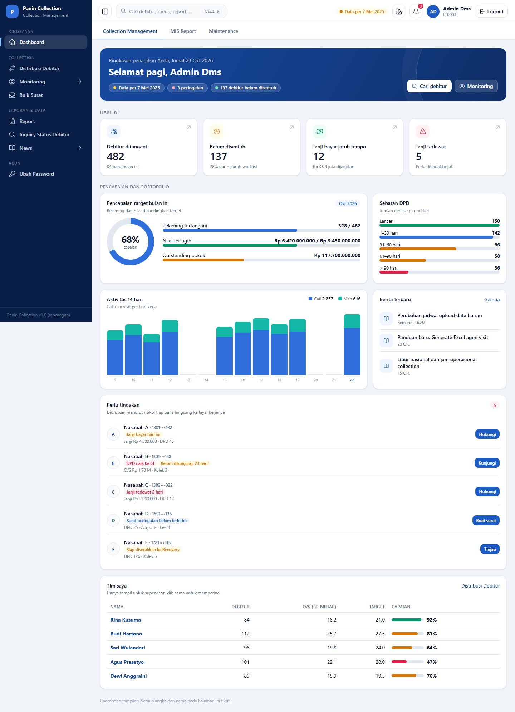
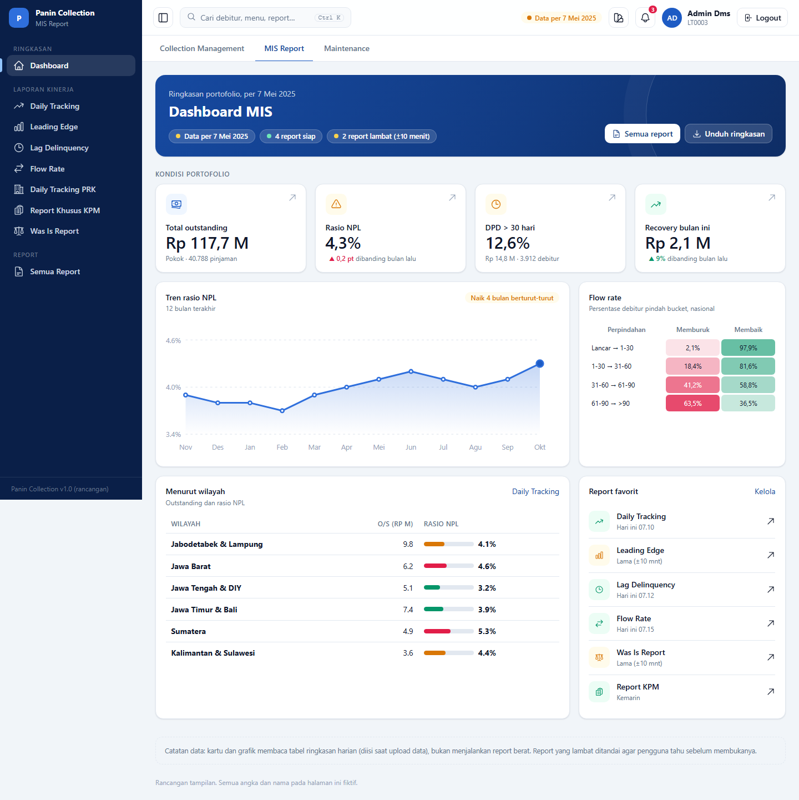
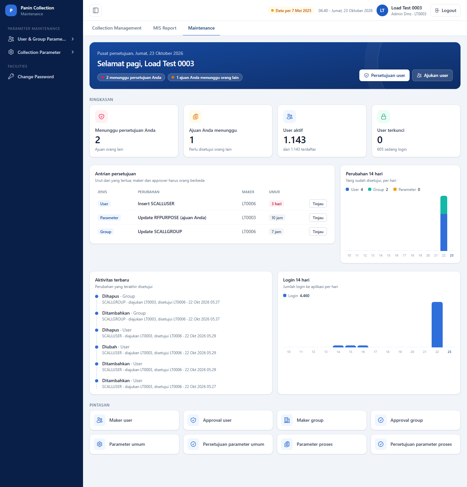
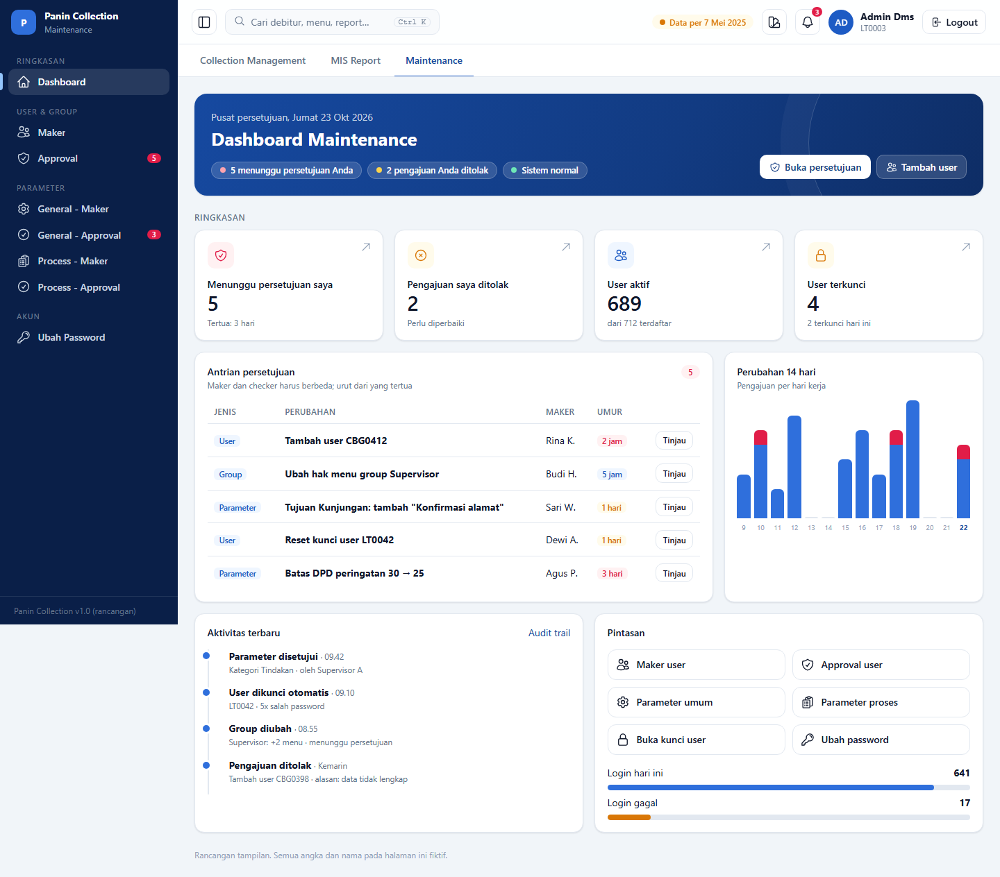
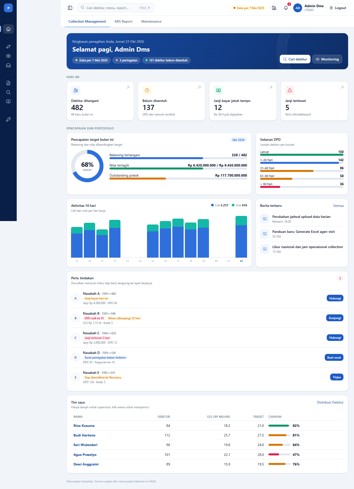
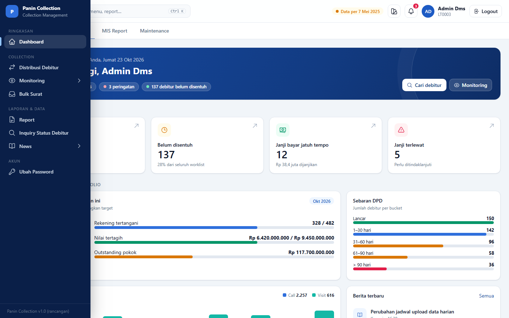
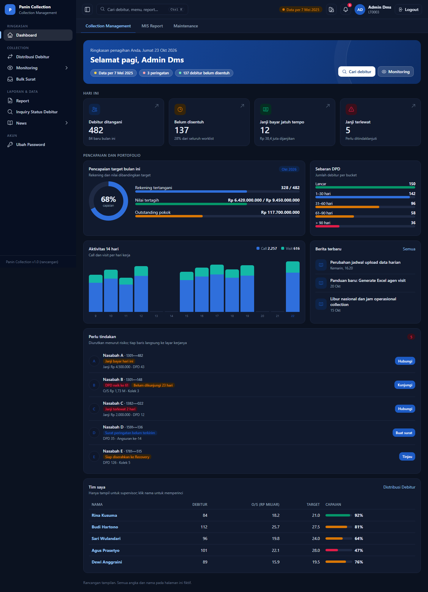
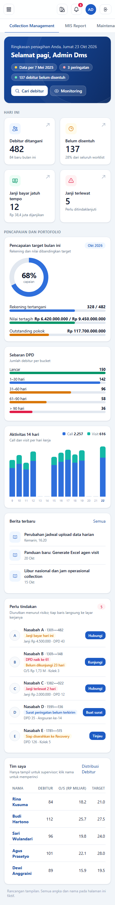

# Rancangan menu samping dan dashboard modul

Status: rancangan **disetujui** (23 Okt 2026). **D1 (shell), D2 (komponen dasar), dan D3 (dashboard Maintenance, data nyata) sudah dikerjakan.** Dashboard Collection (D4) dan MIS (D5) belum. Mockup interaktif: [dashboard-mockup.html](dashboard-mockup.html) (buka langsung di browser; tab modul, Ctrl+B, tombol tema, dan ukuran layar dapat dicoba). Semua angka dan nama di mockup fiktif.

Acuan: menu samping dan dashboard di repo BNPL (`src/Bnpl.Portal`): `MainLayout.razor`, `NavMenu.razor`, `Icon.razor` (Heroicons, MIT), `Home.razor`, `StatCard.razor`, gaya `Styles/app.css`.

## 1. Menu samping

Yang diambil dari BNPL:

| Perilaku | Cara di BNPL | Untuk Panin |
|---|---|---|
| Tampil/sembunyi | Tombol di header (ikon panel) dan **Ctrl+B**; pilihan diingat di `localStorage` (`bnpl.side-hidden`) | Sama, kunci `panin.side-hidden`; semua akses storage di dalam try/catch |
| Menu diciutkan | Menjadi **rel ikon selebar 4,25 rem**; saat disorot atau difokus melebar sebagai lapisan (bayangan) tanpa menggeser isi halaman, label muncul dengan jeda 150 ms | Sama (CSS murni, tanpa JS selain Ctrl+B) |
| Ikon | Satu ikon outline per item (`Icon.razor`, 38 ikon), ukuran 20 px, `currentColor` | Pustaka ikon yang sama; peta ikon disimpan di sisi aplikasi (kolom baru atau berkas konfigurasi), bukan di `RFMENUX` |
| Kelompok | Judul kecil huruf besar; saat diciutkan menjadi garis pemisah | Judul = menu tingkat-1 lama (Collection, Reporting, Inquiry, News, Administrasi) |
| Item aktif | Latar terang + garis biru di kiri; menggulir otomatis ke item aktif | Sama |
| Ponsel/tablet | Di bawah 1024 px menjadi laci geser dengan tirai gelap | Sudah ada sebagian di shell sekarang |
| Lencana angka | Mis. jumlah persetujuan menunggu | Dipakai di Maintenance (Approval) |

Penyesuaian untuk Panin: menu kita **berbentuk pohon sampai 3 tingkat** dan datang dari DB (`RFMENUX`/`GRPMENUX`). Aturan pemetaan:
1. Tingkat-1 menjadi **judul kelompok**; tingkat-2 menjadi **item berikon**; tingkat-3 menjadi **anak yang dapat dilipat** (panah) di bawah item tingkat-2.
2. Saat menu diciutkan, anak tidak ditampilkan sampai sidebar melebar karena disorot.
3. Ikon dipilih dari kamus nama menu → ikon (mis. Distribusi → `arrows-right-left`, Monitoring → `eye`, Inquiry → `search`, Report → `document`); menu tak dikenal memakai ikon `document`.
4. Tab modul tetap di bawah header (tiga modul), karena sidebar hanya menampilkan menu modul aktif.

Header baru: tombol menu, **kotak cari** (Ctrl+K: debitur, menu, report; tahap lanjut), chip **Data per ...** (dari `IDataStatusService`; kuning bila basi), tombol tema terang/gelap, lonceng peringatan (`IWarningService`), pengguna, logout. Footer lama (pengguna, jam) dipindah ke header.

## 2. Prinsip dashboard

1. **Jawab "apa yang perlu saya kerjakan sekarang?"** lebih dulu, baru "bagaimana kondisinya?". Baris atas = hero dengan status + 4 kartu angka yang dapat diklik ke layar kerjanya.
2. **Satu layar, tanpa gulir panjang untuk hal penting**: kartu dan daftar tindakan di atas; tabel rinci di bawah.
3. **Cepat**: dashboard tidak boleh menjalankan report atau SP berat. Tiap widget memuat sendiri-sendiri (kerangka *skeleton* dulu), memakai `SingleFlightCache`, dan gagal sendiri-sendiri tanpa merusak halaman (`PaninErrorBoundary` per widget).
4. **Mengikuti hak akses**: widget hanya tampil bila pengguna punya menu/hak terkait (mis. "Tim saya" hanya untuk supervisor; antrian persetujuan hanya untuk yang berhak).
5. **Jujur soal data**: chip "Data per 7 Mei 2025" selalu terlihat; widget yang bergantung pada data harian menampilkan tanggalnya.
6. **Aksesibel dan responsif**: kontras, `aria-label` grafik dengan ringkasan teks, grid 4→2→1 kolom, mode gelap bawaan sistem.

## 3. Dashboard per modul

### 3.1 Collection Management (kolektor dan supervisor)

| Widget | Isi | Sumber data | Status |
|---|---|---|---|
| Hero | Salam, tanggal, chip: data basi, jumlah peringatan, debitur belum disentuh; tombol Cari debitur dan Monitoring | `IDataStatusService`, `IWarningService`, `IAccountMonitoringService` | ada |
| 4 kartu: Debitur ditangani, Belum disentuh, Janji bayar jatuh tempo, Janji terlewat | Angka + keterangan; klik ke Monitoring/Janji Debitur | ringkasan worklist di `IAccountMonitoringService`; janji dari `IPromiseService` | angka worklist ada; hitung janji hari ini/terlewat **perlu query baru ringan** |
| Pencapaian target | Cincin persen + batang rekening, nilai tertagih, outstanding | `Target`, `Achievement`, `Outstanding` yang sudah dipakai layar Monitoring | ada |
| Sebaran DPD | Batang per bucket (Lancar, 1–30, 31–60, 61–90, >90) | agregat dari worklist pengguna | **query baru** (GROUP BY DPD pada data yang sama dengan worklist) |
| Aktivitas 14 hari | Kolom bertumpuk Call dan Visit per hari kerja | `IActivityMonitoringService` | ada (perlu agregasi per hari) |
| Berita terbaru | 3 berita | `INewsService` | ada |
| Perlu tindakan | Daftar debitur berisiko dengan alasan (janji jatuh tempo/terlewat, DPD naik bucket, belum dikunjungi N hari, surat belum terkirim, siap ke Recovery) dan satu tombol aksi | worklist + janji + riwayat | **aturan prioritas baru**, perlu persetujuan bisnis |
| Tim saya (supervisor) | Tabel bawahan: jumlah debitur, O/S, target, capaian berwarna | `MonitoringTeamMember` (sudah ada di Monitoring) | ada |

### 3.2 MIS Report (manajemen)

| Widget | Isi | Sumber data | Status |
|---|---|---|---|
| Hero | Ringkasan portofolio, tanggal data, jumlah report siap/lambat | `IDataStatusService`, hasil ukur waktu report | sebagian |
| 4 kartu: Total outstanding, Rasio NPL, DPD > 30 hari, Recovery bulan ini (dengan panah naik/turun) | Angka dan perubahan terhadap bulan lalu | **tabel ringkasan harian** (diisi saat upload data); bukan report | **butuh tabel ringkasan baru** |
| Tren rasio NPL | Garis 12 bulan | tabel ringkasan bulanan | **baru** |
| Flow rate | Matriks persen memburuk/membaik antar bucket | SP Flow Rate nasional (sudah ada) dipanggil sekali per hari dan di-cache | ada, perlu cache |
| Menurut wilayah | O/S dan rasio NPL per wilayah dengan batang berwarna | SP Daily Tracking tingkat region | ada, perlu cache |
| Report favorit | 6 pintasan dengan waktu terakhir dan penanda "lama" | daftar report + log ukur | sebagian |

Catatan: beberapa SP report **sangat lambat** (lihat `docs/PERFORMANCE.md` baris 16). Dashboard **tidak boleh** memanggilnya langsung; ia membaca hasil yang sudah dihitung (job malam/Panin.Worker) atau tabel ringkasan.

### 3.3 Maintenance (admin dan checker)

**Sudah diimplementasikan** (`Modules/Maintenance/MaintenanceHome.razor`, `IMaintenanceDashboardService`). Tangkapan layar aplikasi sebenarnya: 

Rancangan awal:

**Penyesuaian terhadap rancangan karena data aslinya:** "Pengajuan saya ditolak" dan "Login gagal" **tidak ada datanya** (penolakan menghapus ajuan tanpa catatan; login gagal tidak dicatat di `SCALLUSERLOG`), jadi diganti "Ajuan Anda menunggu" dan grafik login 14 hari. Sumber: `PARAMETERSYSTEM_TEMPORARY` (antrian), `AUDITTRAIL` (perubahan disetujui), `SCALLUSER`+`SCALLUSERFLAG` (user aktif/terkunci/sedang login), `SCALLUSERLOG` (login per hari). Semua query agregat ringan (≈10 ms pada salinan lokal; `SCALLUSERLOG` 1 juta baris, berindeks tanggal).

| Widget | Isi | Sumber data | Status |
|---|---|---|---|
| Hero | Pusat persetujuan; chip menunggu persetujuan, pengajuan ditolak, status sistem | `IUserMaintenanceService`, `IGroupMaintenanceService`, `IParameterService` | ada |
| 4 kartu: Menunggu persetujuan saya, Pengajuan saya ditolak, User aktif, User terkunci | Angka; klik ke daftar | daftar pending yang sudah dipakai layar Approval; hitung user dari DB login | pending ada; hitung user **query baru ringan** |
| Antrian persetujuan | Jenis (User/Group/Parameter), perubahan, maker, umur berwarna; tombol Tinjau (aturan maker ≠ checker tetap) | sama | ada |
| Perubahan 14 hari | Kolom bertumpuk diajukan/ditolak | tabel riwayat pengajuan | **agregasi baru** |
| Aktivitas terbaru | Lini masa perubahan, penguncian, penolakan | audit/riwayat yang sudah ada | sebagian |
| Pintasan + login | Tombol ke Maker/Approval/Parameter dan batang login berhasil/gagal hari ini | tabel sesi login | **query baru ringan** |

## 4. Tampilan lain

| Menu diciutkan | Disorot (melebar) | Mode gelap | Ponsel |
|---|---|---|---|
|  |  |  |  |

## 5. Rencana pengerjaan (bila rancangan disetujui)

| Tahap | Isi | Ukuran |
|---|---|---|
| D1 ✅ | Shell baru: sidebar rel ikon + Ctrl+B + ikon menu, header (chip data, peringatan, pengguna); kamus ikon `Shell/MenuIcons.cs`; 24 tes unit baru dan uji browser (desktop, rel ikon, sorot, muat ulang, 3 tingkat menu, ponsel). Belum: tombol tema dan kotak cari | M |
| D2 ✅ | Komponen di `Components/Dashboard/`: `DashStat`, `DashHero`, `HeroChip`, `Widget<T>` (skeleton, galat dan tombol ulang per widget), `ColumnChart` (bertumpuk), `LineChart`, `Ring`, `HBars`, hitungan murni `ChartMath` (diuji). SVG/CSS murni, tanpa pustaka | M |
| D3 ✅ | Dashboard Maintenance dengan data nyata (lihat bagian 3.3) | S |
| D4 | Dashboard Collection: widget yang datanya sudah ada dulu, lalu sebaran DPD, janji, aturan "Perlu tindakan" | M–L |
| D5 | Dashboard MIS: tabel ringkasan harian dan job pengisinya (Panin.Worker), lalu widget | L |
| D6 | Mode gelap penuh, kotak cari global (Ctrl+K), pencatatan klik widget untuk menilai guna | M |

## 6. Keputusan yang dibutuhkan

1. **Isi "Perlu tindakan"**: aturan prioritas apa yang disepakati bisnis (mis. janji terlewat > DPD naik bucket > belum dikunjungi)? Ambang hari "belum dikunjungi".
2. **Dashboard MIS**: angka apa yang dipakai pimpinan (rasio NPL dihitung dari kolektibilitas berapa; definisi "recovery"); apakah tabel ringkasan harian boleh dibuat di DB DATA dan diisi saat upload.
3. **Peran**: siapa melihat widget "Tim saya" dan "Antrian persetujuan" (ikuti hak menu atau grup tertentu).
4. **Mode gelap** dan warna/logo resmi Panin (palet sekarang biru netral).
5. **Ikon menu**: setuju dengan pemetaan nama → ikon, atau ingin tambah kolom ikon di `RFMENUX` (mengubah DB lama tidak diperbolehkan; jadi kamus di sisi aplikasi).
